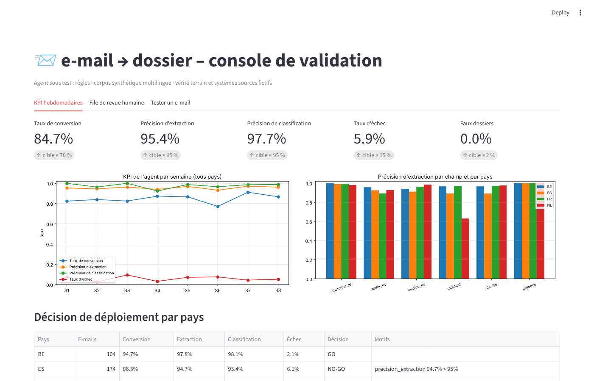
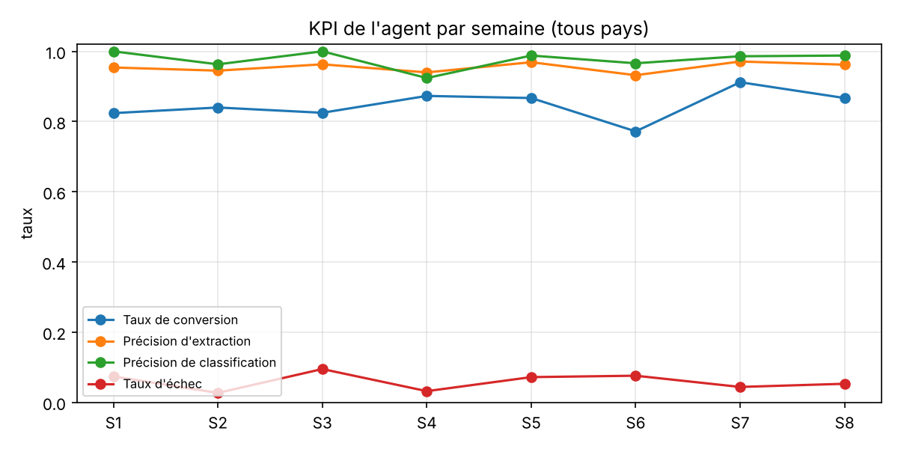
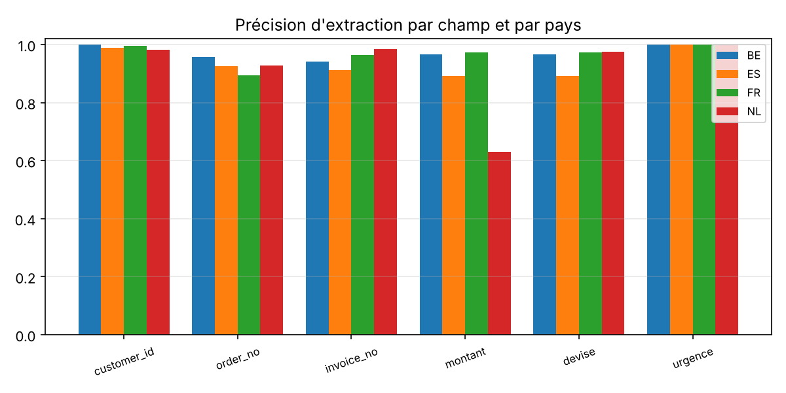
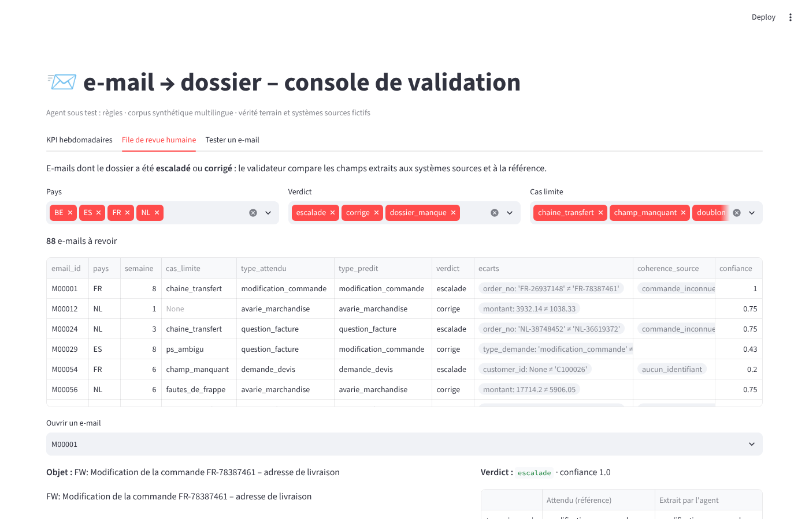

# email-to-case-eval — Validation, KPI et pilotage produit d'un agent IA « e-mail → dossier »

[](https://github.com/Teede-N/email-to-case-eval/actions)


Une PME de transport et logistique **fictive** reçoit chaque jour des e-mails clients : réclamations de livraison, avaries, demandes de devis, modifications de commande, questions de facture. Un agent IA les transforme en dossiers de service (type de demande, client, commande, facture, montant, urgence). Ce dépôt ne porte pas sur l'agent lui-même, mais sur tout ce qu'il faut autour pour le déployer pays par pays en confiance : **validation humain-sur-la-boucle** contre les systèmes sources, **KPI hebdomadaires** par pays / champ / semaine, **cas limites et bugs structurés**, **tests d'API** et **critères d'acceptation Gherkin**, **rapport go / no-go**.



## Résultats du banc (corpus synthétique, 619 e-mails, 4 pays, 8 semaines)

| KPI | Valeur | Seuil |
|---|---|---|
| Taux de conversion (dossier créé sans correction humaine) | **84,7 %** | ≥ 70 % |
| Précision d'extraction (tous champs) | **95,4 %** | ≥ 95 % |
| Précision de classification | **97,7 %** | ≥ 95 % |
| Taux d'échec (escalade ou erreur) | **5,9 %** | ≤ 15 % |
| Faux dossiers (hors périmètre, doublons) | **0,0 %** | ≤ 2 % |

| Pays | E-mails | Conversion | Extraction | Classification | Décision |
|---|---|---|---|---|---|
| BE | 104 | 94,7 % | 97,8 % | 98,1 % | **GO** |
| FR | 217 | 88,8 % | 96,9 % | 98,6 % | **GO** |
| ES | 174 | 86,5 % | 94,7 % | 95,4 % | **NO-GO** (extraction < 95 %) |
| NL | 124 | 67,5 % | 92,4 % | 99,2 % | **NO-GO** (conversion < 70 %, extraction < 95 %) |

Les échecs ne sont pas aléatoires. Le NO-GO néerlandais tient à un seul champ : le montant, juste à 63 % parce que les clients écrivent « € 1.234,56 » et que l'agent remplace alors le montant réclamé par le total de la facture. Chaque cause est un bug reproductible dans [`docs/bugs.md`](docs/bugs.md), relié à une story dans [`docs/user_stories.md`](docs/user_stories.md).

| Cas limite | E-mails | Conversion | Pourquoi |
|---|---|---|---|
| Chaîne de transfert | 35 | 17 % | l'agent retient la dernière commande citée (souvent l'ancienne, annulée) → escalade justifiée |
| Pièce jointe seule | 15 | 27 % | l'information n'est pas dans le texte ; la facture est pré-identifiée via le nom de fichier |
| Post-scriptum ambigu | 44 | 64 % | un PS sur une « modification d'adresse » fait basculer la classification |
| Champ manquant | 42 | 79 % | le client est retrouvé via la commande ou la facture dans les systèmes sources |
| Fautes de frappe | 52 | 96 % | identifiants et montants restent lisibles |

Rapport complet : [`reports/kpi_hebdo.md`](reports/kpi_hebdo.md) · définitions : [`docs/kpi.md`](docs/kpi.md) · décision NL : [`docs/go_no_go_NL.md`](docs/go_no_go_NL.md).

<p align="center">
  
  
</p>

## Ce que contient le dépôt

```
e-mails entrants ──► agent (règles | Claude) ──► dossier + trace ──► validation ──► KPI hebdo ──► go / no-go
                        │ outils : systèmes sources       │ cohérence systèmes sources (prod)     │ par pays, champ, semaine
                        │ (client ↔ commande ↔ facture)   │ comparaison vérité terrain (banc)     │ bugs structurés
```

**Corpus** (`data/generate_corpus.py`) : 619 e-mails synthétiques en français, espagnol et néerlandais (FR, BE, ES, NL), sur 8 semaines, avec vérité terrain et une base SQLite jouant les systèmes sources (clients, commandes de transport, factures). Huit familles de cas limites sont injectées : fautes de frappe, champs manquants, chaînes de transfert, pièce jointe seule, montants avec TVA, post-scriptum ambigus, doublons, hors périmètre.

**Agent** (`src/e2c/extract.py`) : classification par mots-clés multilingues et extraction par expressions régulières, avec deux outils (résolution du client via les systèmes sources, lecture du nom des pièces jointes), détection des doublons, trace par appel (étapes, durée, motif d'échec). Un agent Claude optionnel (sortie JSON contrainte, température 0) se branche avec `ANTHROPIC_API_KEY`. Les faiblesses de l'agent règles sont volontaires : c'est le système « sous test ».

**Validation** (`validate.py`) : d'abord les signaux disponibles en production sans vérité terrain (client inconnu, commande d'un autre client, commande annulée, facture inconnue, montant différent de la facturation), puis la comparaison champ par champ à la référence. Six verdicts : `auto_ok`, `corrige`, `escalade`, `faux_dossier`, `dossier_manque`, `ignore_ok`.

**KPI et rapports** (`kpi.py`, `bugs.py`) : formules documentées, seuils go / no-go, tendances par semaine, précision par champ et par pays, graphiques, bugs structurés (contexte, étapes de reproduction, attendu vs réel, gravité, occurrences).

**API** (`api.py`, FastAPI) : `POST /dossiers/from-email`, `GET /dossiers/{id}`, `GET /metrics/summary`, `GET /health`. Testée par `tests/test_api.py` et par la collection Postman `postman/`.

**Qualité produit** : user stories INVEST (`docs/user_stories.md`), critères d'acceptation Gherkin en français exécutés par pytest-bdd (`features/`, 8 scénarios dont un plan de scénario multilingue), guide d'intégration des testeurs et modèle de bug Jira (`docs/onboarding_testeurs.md`), rapport go / no-go (`docs/go_no_go_NL.md`).

**Console** (`app.py`, Streamlit) : KPI hebdomadaires, file de revue humaine filtrable (pays, verdict, cas limite) avec comparaison attendu / extrait, anomalies et trace, et un bac à sable pour tester un e-mail.



## Installation et utilisation

```bash
git clone https://github.com/Teede-N/email-to-case-eval && cd email-to-case-eval
python -m venv .venv && source .venv/bin/activate
pip install -r requirements.txt

python data/generate_corpus.py                  # corpus déterministe (seed 42)
pytest -q                                       # 33 tests : unitaires, API, Gherkin
PYTHONPATH=src python -m e2c.cli run            # validation complète → reports/, docs/bugs.md
PYTHONPATH=src python -m e2c.cli one M00001     # un e-mail : dossier, trace, attendu
PYTHONPATH=src python -m e2c.cli gonogo NL      # décision de déploiement d'un pays
PYTHONPATH=src uvicorn e2c.api:app --reload     # API (http://localhost:8000/docs)
PYTHONPATH=src streamlit run app.py             # console de validation
```

Exemple :

```
$ PYTHONPATH=src python -m e2c.cli run
619 e-mails · conversion 84.7% · extraction 95.4% · classification 97.7% · échec 5.9% · faux dossiers 0.0%
  BE: GO     conv 94.7% ext 97.8% cla 98.1%
  ES: NO-GO  conv 86.5% ext 94.7% cla 95.4%  ← precision_extraction 94.7% < 95%
  FR: GO     conv 88.8% ext 96.9% cla 98.6%
  NL: NO-GO  conv 67.5% ext 92.4% cla 99.2%  ← taux_conversion 67.5% < 70%; precision_extraction 92.4% < 95%
```

## Structure

```
data/           generate_corpus.py · emails.jsonl · ground_truth.jsonl · reference.sqlite · validations.jsonl
src/e2c/        extract · validate · kpi · bugs · api · cli
features/       email_to_case.feature (Gherkin, français)
tests/          test_extract.py · test_api.py · test_features.py
postman/        collection Postman équivalente aux tests d'API
docs/           kpi.md · user_stories.md · bugs.md · go_no_go_NL.md · onboarding_testeurs.md · captures
reports/        kpi_hebdo.md · kpi.json · graphiques
.github/        CI : corpus, tests, banc de validation, rapport en artefact
```

## Limites et suites

Le corpus est synthétique : les proportions de cas limites sont choisies, pas observées. L'agent règles est volontairement simple ; l'agent Claude n'a pas été évalué ici (pas d'accès API dans l'environnement de développement). Suites naturelles : lecture des montants « € 1.234,56 » (E2C-10), découpage des chaînes de transfert (E2C-9), pondération objet / corps pour la classification (E2C-11), OCR des pièces jointes, et un échantillonnage de validation humaine stratifié par pays et par type de demande pour estimer les KPI de production avec un intervalle de confiance.

## Auteur

Teede Augustin NOUDAMADJO — M2 Big Data & IA. Projet personnel sur la validation et le pilotage de systèmes agentiques en production.
