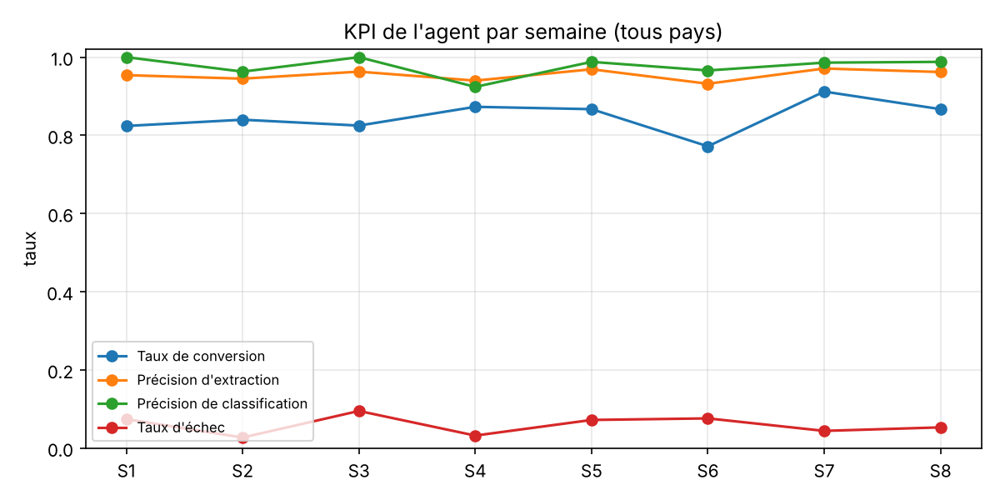
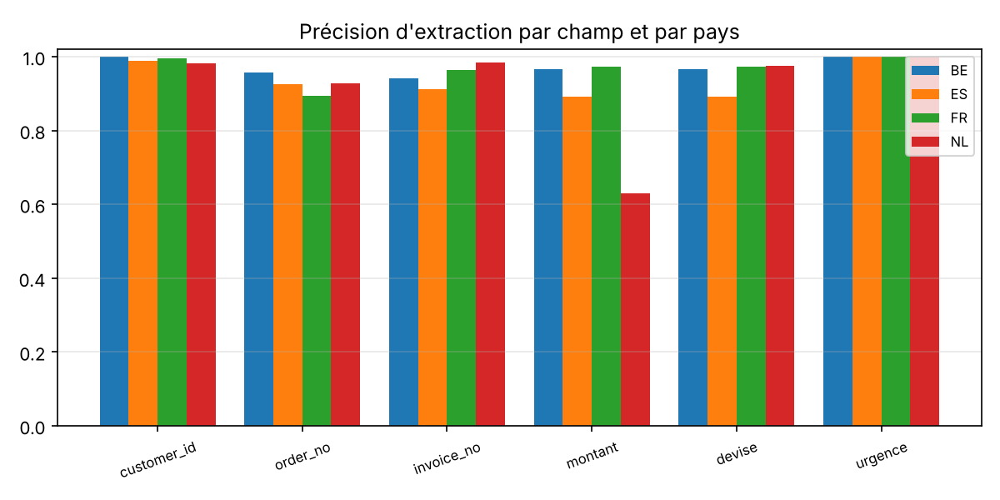

# Rapport KPI hebdomadaire – agent e-mail → dossier (`regles`)

Semaine de référence : **S8** · corpus : 619 e-mails sur 8 semaines, 4 pays. Définitions des KPI : [docs/kpi.md](../docs/kpi.md).

## 1. Vue d'ensemble

| KPI | Valeur | Seuil go/no-go |
|---|---|---|
| Taux de conversion (dossier auto sans correction) | 84.7% | ≥ 70 % |
| Précision d'extraction (tous champs) | 95.4% | ≥ 95 % |
| Précision de classification | 97.7% | ≥ 95 % |
| Taux d'échec (escalade ou erreur) | 5.9% | ≤ 15 % |
| Faux dossiers (hors périmètre, doublons) | 0.0% | ≤ 2 % |
| Dossiers manqués | 0.2% | – |
| Latence médiane | 0.04 ms | – |

Verdicts de validation : auto_ok 486, corrige 53, escalade 34, faux_dossier 0, dossier_manque 1, ignore_ok 45.

## 2. Par pays et décision de déploiement

| Pays | E-mails | Conversion | Extraction | Classification | Échec | Faux dossiers | Décision |
|---|---|---|---|---|---|---|---|
| BE | 104 | 94.7% | 97.8% | 98.1% | 2.1% | 0.0% | **GO** |
| ES | 174 | 86.5% | 94.7% | 95.4% | 6.1% | 0.0% | **NO-GO** (precision_extraction 94.7% < 95%) |
| FR | 217 | 88.8% | 96.9% | 98.6% | 7.6% | 0.0% | **GO** |
| NL | 124 | 67.5% | 92.4% | 99.2% | 5.8% | 0.0% | **NO-GO** (taux_conversion 67.5% < 70%; precision_extraction 92.4% < 95%) |

## 3. Précision par champ

| Champ | Précision |
|---|---|
| type_demande | 97.6% |
| customer_id | 99.1% |
| order_no | 92.0% |
| invoice_no | 95.2% |
| montant | 87.0% |
| devise | 95.2% |
| urgence | 100.0% |

## 4. Tendance par semaine

| Semaine | E-mails | Conversion | Extraction | Échec |
|---|---|---|---|---|
| S1 | 74 | 82.4% | 95.4% | 7.4% |
| S2 | 80 | 84.0% | 94.5% | 2.7% |
| S3 | 69 | 82.5% | 96.3% | 9.5% |
| S4 | 66 | 87.3% | 94.0% | 3.2% |
| S5 | 85 | 86.7% | 96.9% | 7.2% |
| S6 | 87 | 77.2% | 93.2% | 7.6% |
| S7 | 74 | 91.2% | 97.1% | 4.4% |
| S8 | 84 | 86.7% | 96.2% | 5.3% |

## 5. Où l'agent échoue : cas limites

| Cas | E-mails | Conversion | Extraction | Échec | Faux dossiers |
|---|---|---|---|---|---|
| nominal | 358 | 94.7% | 98.9% | 0.0% | 0.0% |
| fautes_de_frappe | 52 | 96.2% | 99.1% | 0.0% | 0.0% |
| ps_ambigu | 44 | 63.6% | 79.0% | 0.0% | 0.0% |
| champ_manquant | 42 | 78.6% | 95.5% | 11.9% | 0.0% |
| chaine_transfert | 35 | 17.1% | 81.0% | 82.9% | 0.0% |
| montant_ambigu | 28 | 92.9% | 98.3% | 0.0% | 0.0% |
| hors_perimetre | 26 | 0.0% | 0.0% | 0.0% | 0.0% |
| doublon | 19 | 0.0% | 0.0% | 0.0% | 0.0% |
| piece_jointe_seule | 15 | 26.7% | 74.6% | 0.0% | 0.0% |

Écarts les plus fréquents (champ prédit ≠ attendu) : montant (46), order_no (37), devise (17), type_demande (14), invoice_no (12), customer_id (5).

Anomalies détectées via les systèmes sources (sans vérité terrain) : commande_inconnue_ou_autre_client (29), aucun_identifiant (5).
